# Phishing Awareness Training

An educational cybersecurity project that teaches people how to recognize, verify and report phishing. It consists of an 18-slide training presentation and a standalone interactive learning module, both available in English and Arabic.

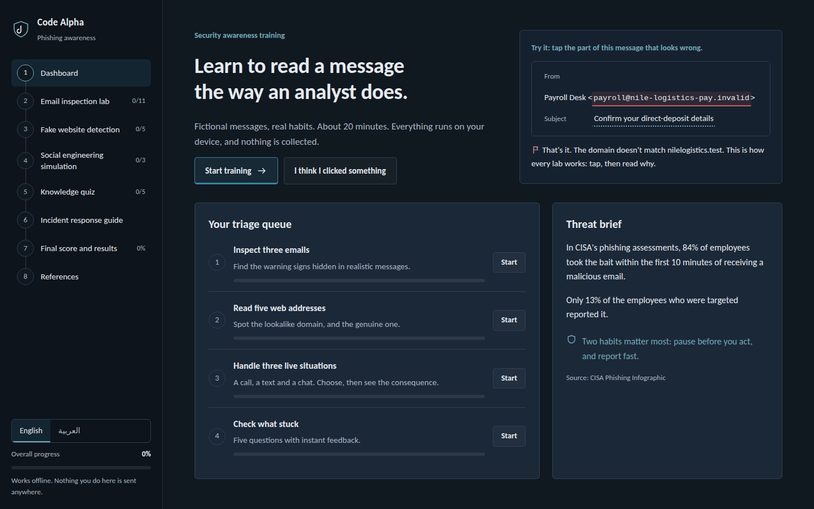

## Introduction

Phishing is the use of fake emails, text messages or phone calls to trick people into giving up credentials, money or access. It works because messages look familiar and create pressure to act quickly. In CISA's phishing assessments, 84% of employees took the bait within the first 10 minutes of receiving a malicious email, and only 13% of targeted employees reported it ([source](docs/REFERENCES.md)).

This project turns that problem into a short, practical training: recognize the warning signs, verify through a channel you trust, and report fast. It was developed as part of my cybersecurity training.

## Learning objectives

After the training, a learner should be able to:

1. Explain what phishing is and the two main ways it is used (stealing login credentials and delivering malware).
2. Spot warning signs in an email: lookalike sender domains, artificial urgency, generic greetings, off-domain links, risky attachments and requests to change payment details.
3. Read a web address correctly and recognize lookalike domains.
4. Respond safely to phone, text and chat approaches (stop, verify through a known channel, report).
5. Know what to do after clicking, opening an attachment, entering a password or paying.

## Main features

Only features that exist in the delivered files are listed.

**Interactive learning module (`web-module/index.html`)**

- **Email Inspection Lab:** three fictional phishing emails. Tap any element to learn whether it is a warning sign. Some elements are normal and are labelled as such. A "warning signs found" meter tracks completion (11 signs across the three emails).
- **Fake Website Detection Lab:** five fictional web addresses. Tap the part of the address that gives the fake away, or confirm the address is genuine. Answers lock after the first attempt and each one is explained.
- **Social Engineering Simulation:** three scenarios (a phone call, a text message and a chat request), each with three possible responses, the consequence of the choice and a lesson. The third scenario includes a documented real case.
- **Knowledge Quiz:** five multiple-choice questions with immediate feedback, explanations, a final score and a retake option.
- **Incident Response Guide:** four situations (clicked a link, opened an attachment, entered a password, paid or shared bank details) with checklists.
- **Final Score and Results:** per-skill breakdown and overall score.
- **References:** the 11 sources used.
- **Bilingual experience:** English and Arabic, with full right-to-left layout and a language switch.
- **Works offline:** a single HTML file with no external requests (links on the References page need internet to open).
- **No credential collection:** the simulated login page contains no input fields. All example domains end in `.test` or `.invalid`.
- **Progress is not saved:** progress lives in memory and resets to zero when the page is refreshed. Only the language choice is remembered.

**Presentation (`presentation/Phishing_Awareness_Training_EN.pptx`)**

- 18 slides in English with detailed Arabic speaker notes on every slide, designed for a 15 to 20 minute session.
- Diagrams, an annotated email mockup, a fake-website comparison, a real-world case study, five quiz slides with click-to-reveal answers, and a References slide with clickable links.
- Phishing prevention best practices appear on the Stop-Verify-Report and layers-of-defense slides. In the module they are built into the lab explanations and the dashboard brief rather than being a separate section.

## Deliverables

| Deliverable | Purpose |
|---|---|
| `presentation/` | Training presentation for instructor-led sessions |
| `web-module/` | Self-paced interactive module (standalone file plus editable source) |
| `docs/` | Project overview, references and verification, QA report, design system, third-party notices |
| `tests/` | Automated test scripts and their recorded results |
| `prompts/` | Development notes, including how AI assistance was used |

## Screenshots

All images below are captured from the final files. The slide images are LibreOffice renderings of the `.pptx`, not PowerPoint screenshots.

| | |
|---|---|
| 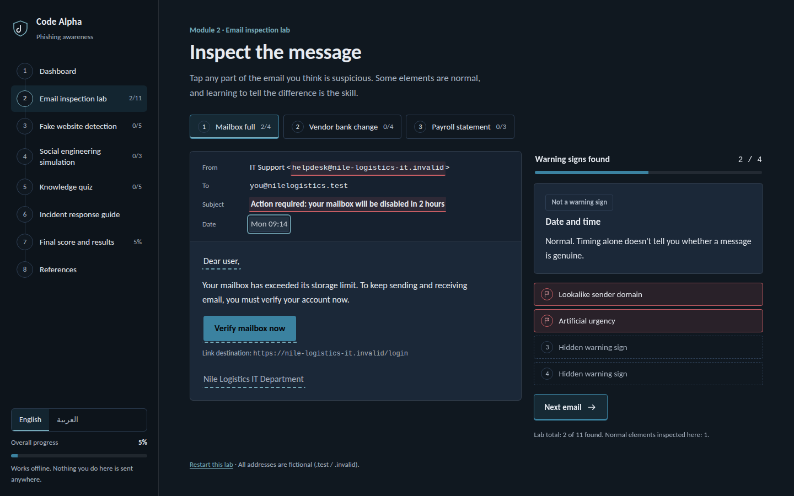 **Email Inspection Lab** | 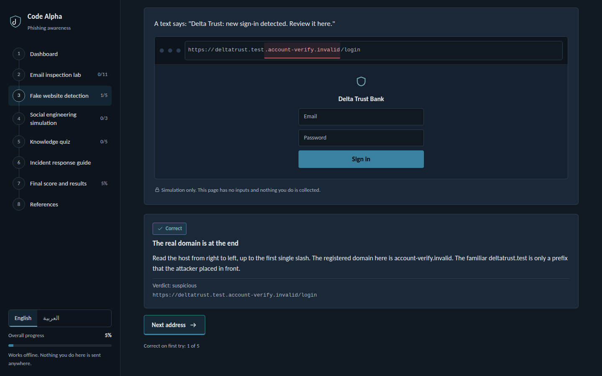 **Fake Website Detection Lab** |
| 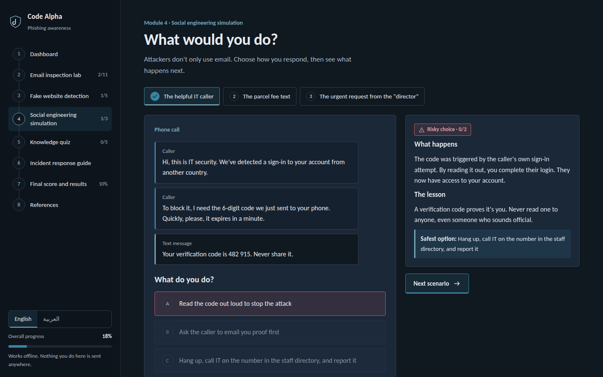 **Social Engineering Simulation** | 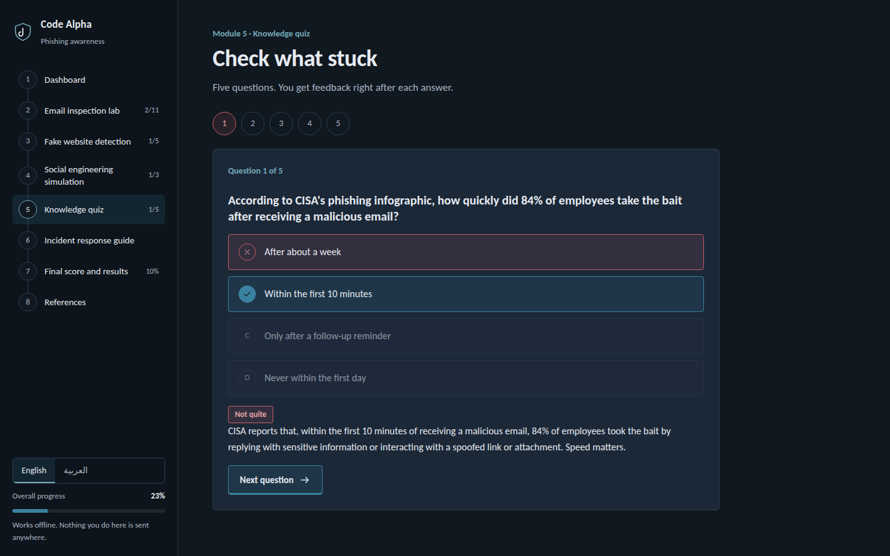 **Knowledge Quiz** |
| 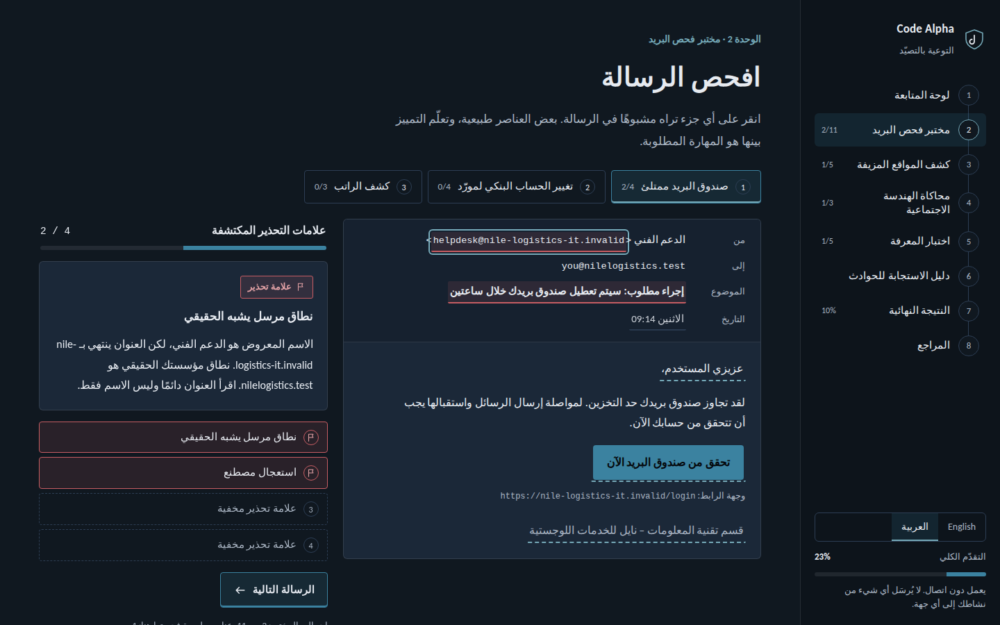 **Arabic, right-to-left layout** | 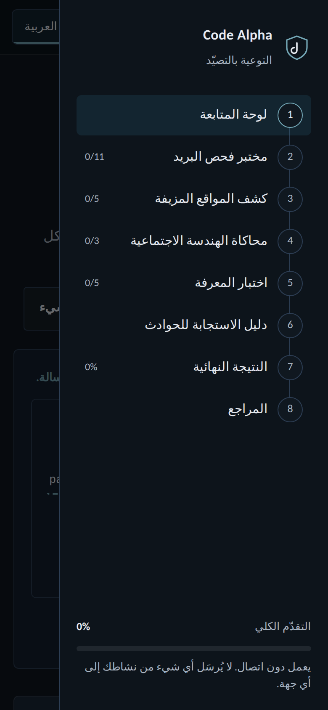 **Mobile menu (Arabic)** |

**Presentation slides**

| | |
|---|---|
| 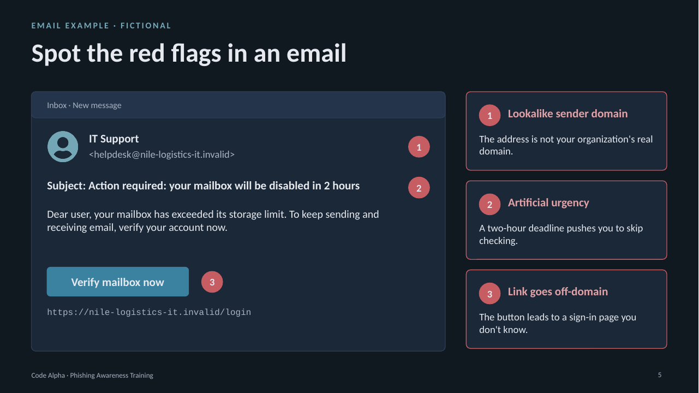 | 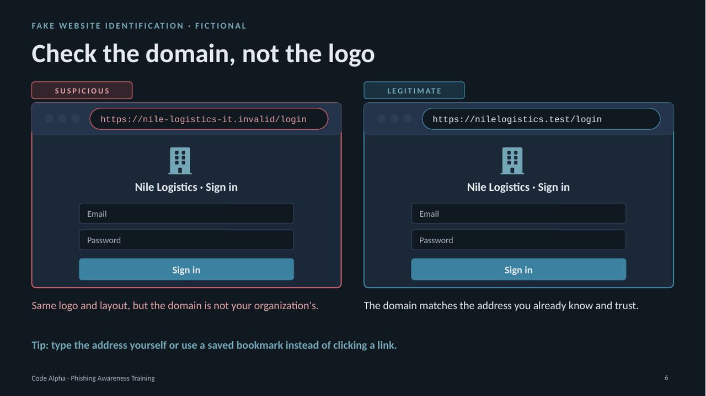 |
| 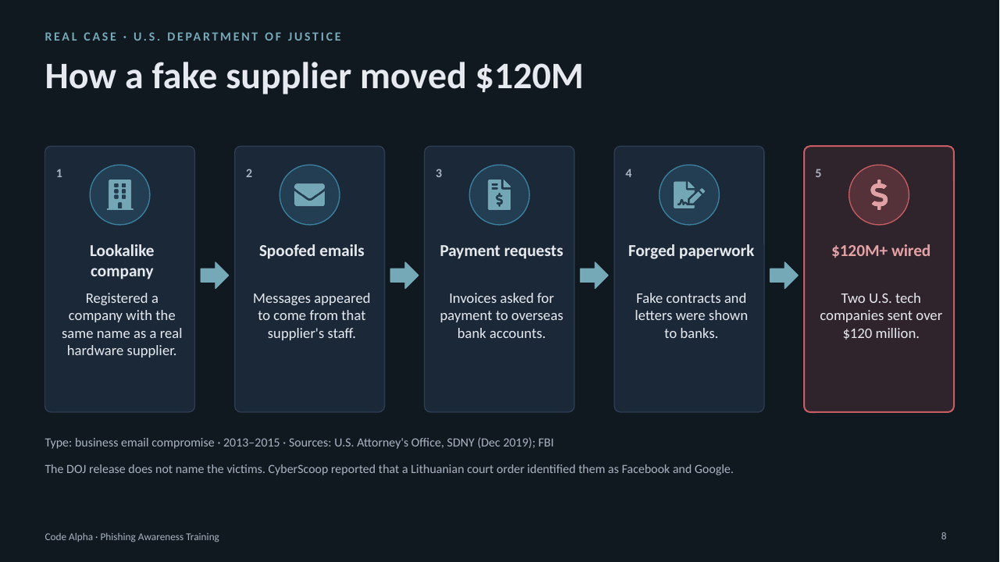 | 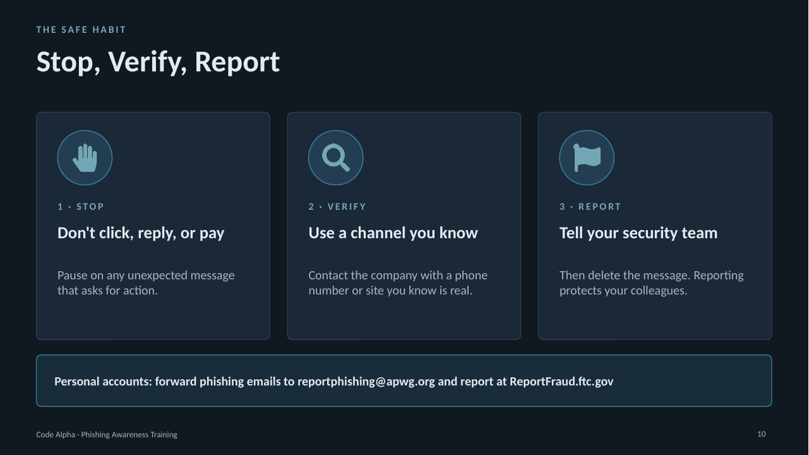 |

More images are in `web-module/screenshots/` and `presentation/screenshots/`.

## Technologies used

| Area | Tools (versions used) |
|---|---|
| Learning module | React 19.2.5, TypeScript source, hand-written CSS (no CSS framework), esbuild 0.27.7 to bundle everything into one HTML file |
| Presentation | PptxGenJS 4.0.1, react-icons 5.6.0 (Font Awesome 5 icons) with sharp 0.34.5 for icon images; a small Python script adds the quiz reveal animation |
| Testing | Playwright 1.56.0 with Chromium 141, python-pptx 1.0.2, LibreOffice 24.2.7 (rendering and file checks) |
| Runtime | Node.js 22 and Python 3.12 were used for building and testing; **viewers need only a browser and PowerPoint** |

## Repository structure

```
phishing-awareness-training/
├── README.md
├── .gitignore
├── presentation/
│   ├── Phishing_Awareness_Training_EN.pptx   18-slide deck, Arabic speaker notes
│   └── screenshots/                          slide renders used in this README
├── web-module/
│   ├── index.html                            standalone module (open directly)
│   ├── README.md                             module details and build steps
│   ├── screenshots/                          screenshots of the running module
│   └── source/                               editable React + TypeScript project
├── docs/
│   ├── PROJECT_OVERVIEW.md
│   ├── REFERENCES.md                         sources and how each was verified
│   ├── QA_REPORT.md                          tests executed and results
│   ├── DESIGN_SYSTEM.md                      Dark Professional Cybersecurity identity
│   └── THIRD_PARTY_NOTICES.md                licenses and attribution
├── tests/
│   ├── README.md
│   ├── qa.js                                 54 Playwright tests
│   ├── http-smoke.js                         GitHub-Pages-style local HTTP check
│   ├── cross_check.py                        deck-versus-module consistency checks
│   └── test-results/                         recorded results (JSON)
└── prompts/
    └── DEVELOPMENT_NOTES.md
```

The module is a genuinely standalone file, so there are no separate `css`, `js` or `images` folders. The styles and script are inlined in `index.html`.

## Installation and usage

**1. Get the files.** Clone the repository or download it as a ZIP and extract it:

```bash
git clone <your-repository-url>
cd phishing-awareness-training
```

**2. Open the learning module.** Double-click `web-module/index.html` (or open it from your browser's File menu). There is nothing to install.

**3. Run it locally over HTTP (optional).** From the repository root:

```bash
python3 -m http.server 8000
# then open http://localhost:8000/web-module/index.html
```

**4. Open the presentation.** Open `presentation/Phishing_Awareness_Training_EN.pptx` in PowerPoint. Use slideshow mode for the quiz: on slides 13 to 17 one click reveals the answer. Arabic speaker notes are in the notes pane.

**5. Offline use.** The module is designed for offline use: it was tested with the network disabled and all outbound requests blocked, and its Content-Security-Policy blocks network calls. The links on the References page open external sites and need an internet connection.

**6. Rebuild the module from source (optional).**

```bash
cd web-module/source
npm install
npm run build        # writes dist/index.html; copy it over ../index.html
```

The build was verified with a pre-installed toolchain (esbuild 0.27.7, React 19.2.5). A fresh `npm install` could not be tested in the offline environment where the project was built. See [`web-module/README.md`](web-module/README.md).

**GitHub Pages.** The module is a single static file and should work on GitHub Pages without changes. It has not been deployed, so that is untested on the live service. See [`web-module/README.md`](web-module/README.md#github-pages) for the steps.

## Testing

Everything below was actually executed. Details, environment and per-test results are in [`docs/QA_REPORT.md`](docs/QA_REPORT.md).

| Check | Result |
|---|---|
| Playwright suite on the standalone `index.html` (navigation, language switching, RTL, all labs, quiz scoring and retake, final score, responsive layouts, keyboard access, contrast, console errors, offline) | 54 of 54 passed |
| Local HTTP check under a project sub-path (GitHub-Pages-style, not a deployment) | 6 of 6 passed |
| Deck-versus-module consistency (palette, fonts, quiz parity, references, notes, placeholders, domains) | 9 of 9 passed |
| PowerPoint file validation, opening with python-pptx, rendering with LibreOffice | Passed |

**Not tested:** browsers other than Chromium, real phones or tablets, screen readers, playing the quiz animation inside PowerPoint, and a fresh `npm install` (no network). Arabic wording has not had a native-speaker review.

## Safety and educational disclaimer

This project is for cybersecurity education and awareness. All organizations, people, emails, phone calls and websites in the examples are **fictional**, and all example domains use the reserved `.test` and `.invalid` suffixes. The simulated login page has no input fields and the module collects no data.

Do not use these examples, scenarios or code to collect credentials, deceive people, compromise systems or access accounts without authorization. Techniques are described only to help people recognize and report them.

## References

The statistics and recommendations come from CISA, the FBI, the FTC, the U.S. Department of Justice and NIST. The full list, what each source supports and how each link was verified is in [`docs/REFERENCES.md`](docs/REFERENCES.md). Two limits to keep in mind:

- The FBI IC3 2025 figures come from press coverage; the primary report was not opened.
- CISA's 84% statistic is repeated exactly as CISA words it, without an added interpretation.

## License

No license has been chosen yet, so by default all rights are reserved. The decision depends on content ownership and third-party attribution, which are summarized in [`docs/THIRD_PARTY_NOTICES.md`](docs/THIRD_PARTY_NOTICES.md). Add a `LICENSE` file once you decide.

## Author

**Kerolos Naguib Aldabaa Fahim**
**GitHub:** [https://github.com/Kerolos-Naguib]
